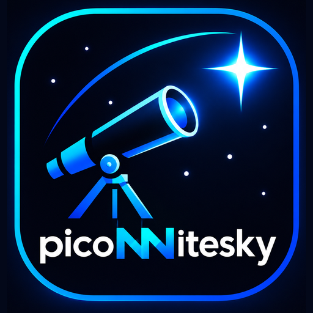

# PicoNNitesky

**A cross-platform astrophotography studio for Windows and Raspberry Pi setups**

Plan your targets, control your mount, capture images, and bring essential observing tools together in one place.

---

## About

PicoNNitesky is a desktop application concept for making astrophotography and telescope sessions easier to manage. It brings observing, imaging, equipment planning, and focus tools into a single workspace. The project supports Windows as well as Raspberry Pi-based setups.

The project is intended for astronomers and astrophotography enthusiasts who want a practical control centre for their observing setup.

## Planned capabilities

- **Camera capture** — work with supported astronomy cameras and compatible DSLR equipment.
- **Focus assistance** — analyze focus patterns and help achieve accurate focus.
- **Telescope mount control** — connect to supported mounts for slewing, tracking, and alignment.
- **Equipment and back-focus planning** — organize optical-train components and calculate spacing.
- **Target planning and sky map** — explore targets and prepare an observing session.
- **Observing environment** — bring useful site and sensor information into the workflow.

*Compatibility and feature availability depend on the hardware, operating system, and required drivers.*

## Project status

🚧 **Early project / documentation-first repository**

This GitHub page is currently a project introduction. Source code, build instructions, downloads, and detailed setup documentation will be added when they are ready.

## Platform and technology

The project supports Windows desktop use and is also designed with Raspberry Pi telescope workflows in mind. The application is built around C++ and a graphical interface. Hardware compatibility and available features may vary by operating system, drivers, and connected equipment.

## Project icon

The PicoNNitesky icon is included in [`assets/piconnitesky.png`](assets/piconnitesky.png).

## Roadmap

- [ ] Publish the initial source code
- [ ] Add installation and build instructions
- [ ] Document supported cameras and telescope mounts
- [ ] Add screenshots and usage guides
- [ ] Publish releases and version notes

## Contributing

There is no contribution workflow yet. Once the source code and project guidelines are published, this section will explain how to report issues and contribute.

## License

A license has not been specified yet. Until one is added, all rights remain with the respective copyright holder(s); do not assume the project is open for reuse or redistribution.
